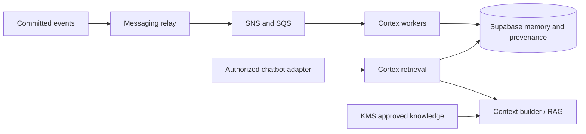

# Cortex

Cortex is KaoJai's scoped memory service, powered by self-hosted Mem0 OSS.
It extracts and recalls remembered experience. Approved shared knowledge has a
separate review/publishing boundary owned by KMS and application contracts.

The initial source is conversation evidence. Other source types are future work;
this extraction does not add a generic ingestion API or change eligibility.

## Runtime

One Python 3.12 container serves five separate AWS Lambda functions:

| Function mode | Trigger | Input | Output |
| --- | --- | --- | --- |
| `intake` | Customer-memory SQS | Durable event reference | Eligible, coalesced work in PostgreSQL |
| `knowledge-intake` | Independent knowledge SQS | Durable event reference | Independently selected candidate work |
| `extraction` | Delayed extraction SQS | Work event reference | Mem0 generation with evidence provenance; private knowledge candidates |
| `maintenance` | Maintenance SQS | Publication or cleanup event | Exact approved text publication or obsolete-generation cleanup |
| `retrieval` | IAM Lambda invocation | `search`, `knowledge_search`, `list`, or `health` request | Authorized scoped memories, published knowledge, or storage readiness |

This is a hybrid worker/internal RPC service. It has no HTTP server, API Gateway,
public Function URL, or always-running process. `CI_MODE` rejects the wrong trigger
shape. SQS handlers return partial batch failures. Retrieval derives allowed scopes
through database authorization; callers must supply trusted tenant/conversation
identifiers, never arbitrary Mem0 filters.



Mem0 performs extraction and semantic retrieval. KaoJai's database/application
contracts own selection, authorization, revisions, model budgets and review.
Customer memory does not become company policy. Knowledge candidates stay private
until an authorized reviewer approves them; publication uses `infer=False`.

## Ownership and migration

Extracted from [stateless-apps PR #353](https://github.com/kaojai-ai/stateless-apps/pull/353),
source `a8f7ac162dd10fa3092ded8a2f3918aeee4448ac`. Tracks
[Customer Memory delivery #44](https://github.com/kaojai-ai/backlog/issues/44).

- Cortex owns Python source, dependency lock, tests and container builds.
- `db-contracts` owns the private `conversation_intelligence` schema, migrations,
  authorization RPCs, coordination, reviews and generated contracts.
- `infra` owns Lambdas, aliases, queues, IAM, ECR and runtime configuration.
- `messaging-workers` owns the persistent event relay.
- KMS remains separate; Cortex is not the company knowledge management UI.

Repository/package names change to Cortex. Existing AWS resource names, ECR path,
`CI_*` variables, database schema and request contracts remain stable. This avoids
recreating deployed resources or breaking callers during the source move.

Image publication and alias release are separate from source merge. Development
may deploy an exact tested draft-PR SHA. The pilot remains disabled. The regional Lambda
concurrency quota is 10, so provisioning-only mode cannot enable consumers, the
relay or application callers. Increase quota and verify reserved capacity before
pilot enablement. Real-model quality, end-to-end events and retrieval latency are
separate acceptance gates.

## Development

```sh
uv sync --frozen
uv run pytest -q
```

Two integration tests require `CI_TEST_DATABASE_URL` pointing to a disposable,
migrated local database; the role-switch test explicitly rejects remote endpoints.
Tests use fake model/embedding adapters and do not call OpenAI. Never use a live
tenant database as a test fixture.

```sh
docker build --platform linux/amd64 -t cortex:local .
```

Mem0 OSS 1.0.11 and dependencies are pinned in `uv.lock`. The schema-qualified
pgvector and PostgreSQL history adapters never create tables at runtime or use
SQLite history. Graph memory, model reranking and telemetry remain disabled.

Runtime variables: `CI_MODE`, `CI_PIPELINE`, `APP_ENV`,
`CI_DATABASE_SECRET_ARN`, `CI_OPENAI_SECRET_ARN`. Dedicated Secrets Manager values
are raw strings. The database login inherits `ci_worker`; never use a migration
login. Secrets are loaded without logging values. Local tests may use
`CI_DATABASE_URL` and `OPENAI_API_KEY` instead.

## Delivery

PR checks run locked tests and build an AMD64 Lambda image without publishing.
The **Build development Cortex image** workflow publishes an immutable SHA tag
and digest, but does not update a Lambda or alias. Tested same-repository PRs
can invoke it using the `deploy-dev` label; manual dispatch is available after
the workflow reaches main. It requires a
`development` GitHub environment and these non-secret environment variables:

- `CORTEX_IMAGE_ROLE_ARN`: the dedicated Cortex ECR publishing role from infra.
- `CORTEX_ECR_REPOSITORY`: existing development Mem0 ECR repository name.
- `CORTEX_AWS_REGION`: `ap-southeast-7`.

The role trusts only `repo:chaintng@2979072/cortex@1413978984:environment:development`. It can publish
images and read the environment marker, not read/write database or OpenAI secrets.
Configure environment branch/reviewer protections through the normal protected
release path before enabling image publication. No production workflow is added.

Rollout: review tested source → apply development OIDC change → configure protected
repository environment → build Cortex image → review infra digest change → apply
and explicitly release aliases → run storage health verification. Runtime enablement
and real-model pilot acceptance remain separate. Retire the stateless-apps build
entry point only with this source extraction; retained ECR images keep existing
functions runnable.

See [the repository layout and service boundaries](docs/architecture.md).
